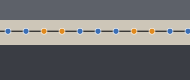
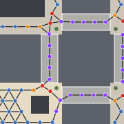

# The walk graph

How the city's walkable ground becomes the graph the planner moves blobs on:
where the geometry comes from, how `nav.Build` turns it into nodes and edges,
the rules the result keeps (and why each one matters for blobs never touching),
and the numbers for the real city.

How blobs then move on the graph, one edge per tick and without collisions,
is in [PIBT.md](./PIBT.md).


*Blue: standing spots. Orange: grid gaps filled in (mostly in front of doors).
Purple: chains across zebra crossings. Red: bridges round block corners and
other tight gaps. Dark boxes are buildings and kiosks; green discs are lamps
and trees. Everything is SIMULATED.*

## Where the geometry comes from

The TypeScript scene owns the city's layout. The Go side never recomputes it;
it reads an export.

```
web/src/scene/layoutCity.ts      the city: blocks, plaza, park, lamps, trees, standing spots
web/src/scene/cityMapExport.ts   picks out what walking needs
        │  make citymap  (node web/scripts/export-city-map.ts)
        ▼
internal/sim/citymap/city.json   committed; make check fails if it is stale
        │  go:embed, citymap.Load()   strict decode and validation
        ▼
nav.Map                          areas with spots, crosswalks, discs, boxes
        │  nav.Build(m, nav.DefaultParams())
        ▼
*nav.Graph                       citymap.Graph() builds it once and caches it
```

`city.json` (version 1) holds:

- **34 areas**, each an axis-aligned rectangle with its standing spots: the
  plaza, the park lawn and 32 sidewalk strips. Concatenated in order, the
  **752 spots** are the Stand nodes 0..751, the only places a blob may stand
  and the only possible goals.
- **24 crosswalks**, kerb to kerb across the road, each with the axis a blob
  walks along to cross.
- **50 discs** (36 lamps, 14 park trees) and **15 boxes** (13 buildings, 2
  kiosks): the obstacles. Doorsteps are left out on purpose: blobs never
  *stop* in front of a door, but walking past one is fine.

`citymap.Load` rejects unknown fields, trailing data, another version, a blob
radius other than `nav.DefaultParams().Radius`, a spacing other than 1.8, and
any spot off its area's hex grid or closer than a radius to its area's edge.
A stale or hand-edited file fails loudly instead of building a subtly wrong
graph.

## The rules a graph must keep

Every edge is one step a blob may take in one tick. The planner's guarantee
(no two blobs ever closer than `MinSep = 1.2`, two body radii) holds only if
the graph keeps these rules. `nav.Check` checks them all by brute force, and
`Build` refuses to return a graph that fails:

| Rule | Limit | Why |
|---|---|---|
| Nodes are apart | ≥ `MinSep` 1.2 | two blobs standing on neighbouring nodes don't overlap |
| Edges keep clear of other nodes | ≥ `MinSep` | a blob walking an edge never brushes one standing still nearby |
| Edges are short | ≤ `MaxEdge` 1.95 | a step fits in one tick, and the move-conflict table stays local |
| Corridors let a queue through | swept gap ≥ `MinSep` | at a node with exactly two neighbours that aren't linked to each other, one blob can step in while the one ahead steps out; otherwise a queue in a 1-wide corridor jams |
| Conflict table is exact | matches `Swept` | the planner looks clashes up instead of computing them |
| Stand nodes are the spots | equal, in order | goals and spawn points line up with the scene |
| Nodes and edges stay on the ground | inside areas ∪ crosswalks | nobody walks on the road except on a zebra |
| …and off obstacles | ≥ `Radius` 0.6 | a blob's body never enters a lamp, tree, kiosk or wall |
| One piece | every node reaches node 0 | every blob can reach every goal |
| Every crosswalk is crossed | a chain of edges inside it | the city's blocks are joined only where the zebras are |

The first five are `CheckGraph` (W1's, in `graph.go`); `Check` adds the
geometry. A *pocket*, a node whose two neighbours are linked to each other
(the 60° corner of a hex area), is not a corridor. Blobs may pass over it but
`GoalOK` never makes it a goal (see PIBT.md).

```
 corridor node v              pocket v
   a ── v                       a ─── b
        │   a→v and v→b at       ╲   ╱    a and b are linked, so nobody
        b   once: must stay       v       needs to pass through v
            ≥ 1.2 apart
```

## The build, stage by stage

`nav.Build` is pure and deterministic: standard library only, no clock, no
randomness, no map iteration, and every computed coordinate rounded to 1e-6.
Edges are never chosen one by one. They follow from the nodes by one rule
(the *edge rule*, `linkable`): two nodes link if they are at most `MaxEdge`
apart and the segment between them stays on walkable ground, keeps `Radius`
from every obstacle and `MinSep` from every other node. Every stage just adds
(or removes) nodes. Each addition is all-or-nothing: it is kept only if it
does what it was for, doesn't split the graph, and leaves every corridor it
touched passable.

Numbers in brackets are for the real city.

### 1. Standing spots (752 nodes, 81 pieces)

The spots, in order, become Stand nodes 0..751. With the edge rule alone they
fall into 81 separate pieces. Sidewalks are cut at every doorway and don't
meet round block corners, the park lawn doesn't reach its sidewalks, and
nothing crosses a road.

### 2. Grid fill (+145 → 897 nodes, 31 pieces)

Spots keep a blob's *reach* (0.85) from obstacles and doorsteps, so it can
idle without clipping. A blob only passing through needs just its *radius*
(0.6), and doorsteps don't block it. So each area's hex grid is rebuilt from
its first spot, and every cell that is inside the area, a radius from the
walkable outline and from obstacles, and at least `FillGap` (1.4) from every
node so far, becomes a Fill node. It goes area by area, row by row.

This refills the holes in front of doors and joins the park lawn to its
sidewalks. The clearance is measured to the outline of all walkable ground,
not the area's own rectangle, because where a lawn meets its sidewalk there
is no kerb.



### 3. Crosswalk chains (+121 → 1,018 nodes, 19 pieces)

Roads are 7 wide and edges at most 1.95, so each crosswalk needs a chain of
nodes. For each one:

1. **Land.** From the kerb point on the crosswalk's centreline, route to the
   nearest node on that side of the road: Dijkstra on a 0.1 grid,
   8-neighbour, integer costs 10 and 14, ties to the lower cell index,
   keeping `Radius + Margin` (0.7) from obstacles.
2. **Pull straight.** Shortcut the grid path wherever the straight line stays
   clear, leaving a few straight segments.
3. **Join** landing, centreline, landing into one line from a node on one
   side to a node on the other.
4. **Place nodes** along it with a small dynamic program: as few new nodes as
   possible, steps as close to `ChainStep` (1.75) as they can be, each step
   passing the edge rule, new nodes at least `BridgeGap` (1.25) from
   everything, and every new node passable as a corridor. An existing node
   within 1.0 of the line can be used on the way instead of crowding it. It
   first asks for an extra `Margin` (0.1) on every limit, and drops that only
   if nothing fits.

All 24 succeed. Straight landings would fail at the two plaza mouths wedged
between a kiosk and a corner lamp. Routing goes round the kiosk:



### 4. Gap bridges (+46 Bridge, −14 Fill → 1,050 nodes, 1 piece)

What is left are places where two nodes are a short walk apart but the graph
only links them the long way round, or not at all. The worst are block
corners. A corner lamp stands 0.8 in from both kerbs, and the gap between it
and the building corner is only about 0.9 wide for a blob's centre. The
nearest spots on two sidewalks meeting at a corner are 3.4 to 6.9 apart.

Every pair of nodes 1.95 to 7.5 apart is a candidate if walkable ground runs
straight between them and the graph needs more than `ceil(d / 1.8) + 4` hops.
Candidates go shortest first. A pair is skipped if either end has no room for
a new node within a step, ignoring Fill nodes, which may be cleared. The
park's west edge is the main such case: the lawn's grid and the sidewalk's
zigzag end up 2.2 to 2.4 apart, just over one step, with no room between.
Each remaining pair gets, until one works:

1. a **routed chain** (A* on the 0.1 grid, pulled straight, nodes placed as in
   stage 3, with the margin), first as is and then after clearing the Fill
   nodes crowding its line;
2. **one, then two hand-placed points** on a 0.05 grid round the pair, chosen
   to leave the most room against every limit (obstacles, spacing, edges
   brushing nodes, passing through), first as is and then with the window's
   Fill nodes cleared (Stand nodes are never removed);
3. a routed chain **without** the margin, as a last resort.

On the real city that is 13 routed chains, 19 one-point and 7 two-point
bridges, with 14 Fill nodes cleared to make room. The five tightest corners,
where an east sidewalk's zigzag meets its north or south sidewalk, take two
points each and leave at least 0.11 to spare. To get that room some swing
out to 0.4 from the kerb, so a blob rounding the corner leans 0.2 over the
road. That is allowed: only obstacles block.

![Block [1,-1]'s north-east corner: the north sidewalk's row and the east sidewalk's zigzag joined by two red Bridge nodes threaded between the corner lamp and the building](./city-graph-corner.svg)

### 5. Edges and corners (1,934 edges)

Nodes cut off from Stand node 0 would be removed (there are none). The edge
rule then links every pair one last time. One corridor turns too sharply to
pass: the park's south-east corner, where the sidewalk row and the lawn's grid
meet 1.5 apart at 90° (swept gap 1.176 < 1.2), with no room for a third node.
That node drops one edge and becomes a dead end, where a blob can step in and
back out. An edge is only dropped if the graph stays in one piece and the
node at its other end still passes. If any Stand node is unreachable at the
end, `Build` returns an error. It never drops a spot.

Finally `FromEdges` builds the planner's tables and `Check` re-verifies
everything above.

## The real city

| | |
|---|---|
| Nodes | 1,050: 752 Stand, 131 Fill, 121 Crossing, 46 Bridge |
| Edges | 1,934 |
| Pieces | 1 |
| Closest two nodes | 1.2886 (`MinSep` 1.2) |
| Dead ends | 1 (the park's south-east corner) |
| 2-core | 1,049 nodes; 751 of 752 Stand nodes |
| Possible goals (`GoalOK`) | 751 of 752 Stand nodes (99.9%); no Stand node is a pocket |
| Fingerprint | `0x34ba2bfb0e4cfd59`, the same on arm64 and amd64 |
| Build time | ~180 ms on an Apple M1, of which `Check` is ~50 ms |

Per stage: fill ~8 ms, crosswalk chains ~20 ms, gap bridges ~100 ms, then
`FromEdges` and `Check`.

## Why builds are bit-stable

The graph's shape depends on hundreds of threshold tests (is this 1.95 or
1.9500001?), so the same input must give the same bits on every machine:

- Every product in a threshold test is wrapped in `float64(...)`. That stops
  Go fusing `a*b + c` into one FMA instruction, which it does on arm64 but not
  on default amd64, and which rounds differently.
- Computed node coordinates are rounded to 1e-6.
- Spatial lookups use a dense bucket grid and return ids sorted, never Go map
  iteration order. Routing breaks ties by cell index.
- The builder keeps 1e-7 inside the limits `CheckGraph` tests with slightly
  different formulas (`math.Hypot`, `Swept`).

`TestGraph` pins the fingerprint, so any change to the city or the build shows
up as a failing test. The arm64 and amd64 builds give the same fingerprint
(checked by running the amd64 test binary under Rosetta).

## Regenerate and inspect

```sh
make citymap                                   # re-export city.json after changing the scene
go test ./internal/sim/citymap -run TestGraph -v   # counts, spacing, 2-core, goals, fingerprint
go test ./internal/sim/citymap -run TestSVG \
    -svg ../../../docs/engine/city-graph.svg   # this page's pictures (crops go next to it)
go test ./internal/sim/citymap -run XXX -bench . -benchtime 10x   # Build and Check timings
```

If the fingerprint changes on purpose, look at the new picture, update
`cityFingerprint` in `citymap_test.go`, and say why in the commit.

## Where in the code

| File | What |
|---|---|
| `internal/sim/citymap/city.json` | the exported geometry (`make citymap`) |
| `internal/sim/citymap/citymap.go` | `Load` (strict decode, grid check), `Graph` (build once, cached) |
| `internal/sim/citymap/svg_test.go` | the pictures on this page, behind `-svg` |
| `internal/sim/nav/types.go` | `Map`, `Params`, `DefaultParams`, `Kind` |
| `internal/sim/nav/geometry.go` | distances, the walkable `union` (outline, segment containment), `obstacles`, the node index |
| `internal/sim/nav/build.go` | `Build`, stages 1 and 2, the edge rule (`linkable`), pass-through (`passes`), hops and pieces |
| `internal/sim/nav/chain.go` | grid routing (A* / Dijkstra), string pulling, chain placement (`placeChain`), all-or-nothing changes |
| `internal/sim/nav/stages.go` | stage 3 (`crossings`), stage 4 (`bridges`, `brute`), stage 5 (`prune`, `trim`) |
| `internal/sim/nav/check.go` | `Check`: `CheckGraph` plus the map's geometry |
| `internal/sim/nav/graph.go` | `FromEdges`, `CheckGraph`, `GoalOK` (see PIBT.md) |

## How it is tested

- **Geometry**: distances, segment/rect clipping, the union's outline and
  segment containment on an L with a crossing, obstacles, rounding, the node
  index.
- **Edge rule**: length, ground, a lamp 0.5 and 0.65 off, a bystander 1.1 and
  1.25 off, a segment cutting a corner.
- **Build on small maps**: one rect gives exactly its hex grid; a road with a
  crosswalk gives a chain on its centreline; without the crosswalk the build
  fails; a doorway gap is filled exactly; a copy of the tightest corner gets
  bridged; a walled-off gap fails; pocket corners keep their edges and aren't
  goals; a too-sharp corridor (the park's corner) is cut to dead ends; bad
  input is rejected; two builds are identical.
- **Check catches**: a node nudged 0.3, a Stand node moved off its spot, a
  crosswalk narrowed off its chain, an edge through an obstacle, a node too
  near one, an edge leaving the ground, two pieces, an unchained crosswalk, a
  missing spot, a dropped conflict entry, a too-sharp corridor.
- **Real city**: `Load` and malformed inputs; `Graph()` is one piece with all
  752 spots, passes `Check`, keeps ≥ 95% of spots as goals, and matches the
  pinned fingerprint.
- **Mutations** (each applied by hand and reverted): skipping crosswalk
  chains, skipping bridges, `MinSep` 1.0 in the edge rule, no obstacle
  clearance for edges, and grid fill ignoring `FillGap` each fail both small-map
  and real-city tests.
